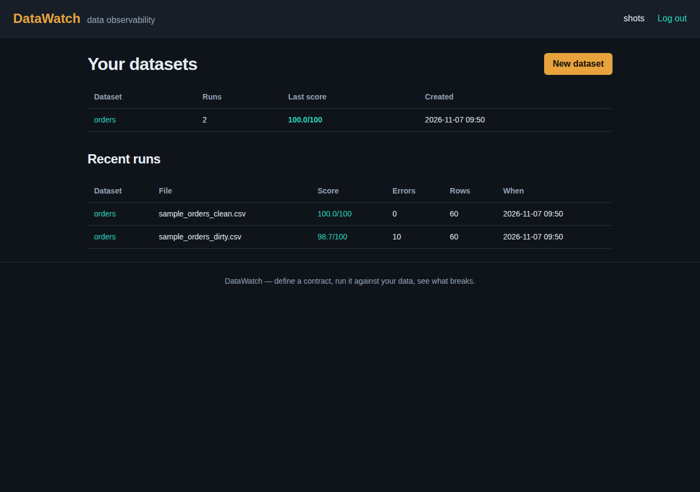
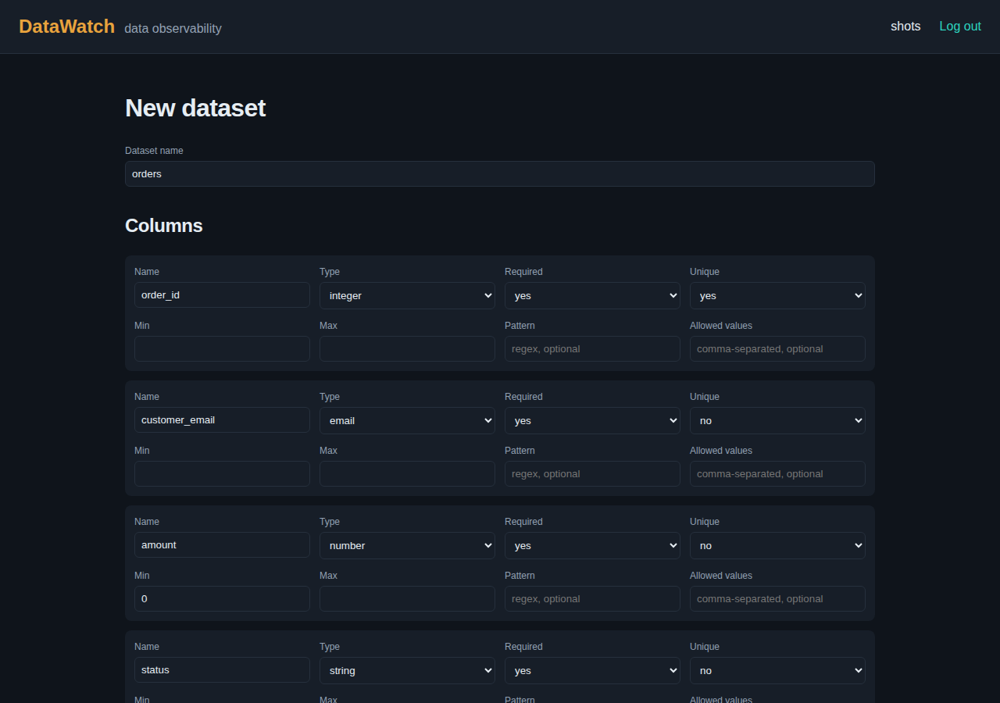
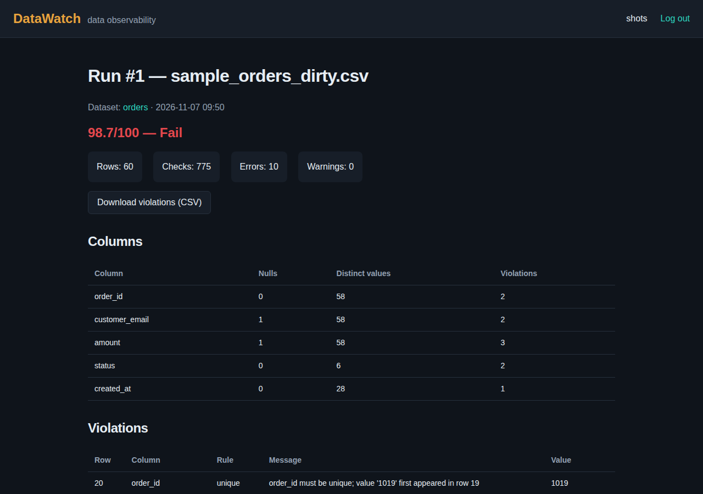
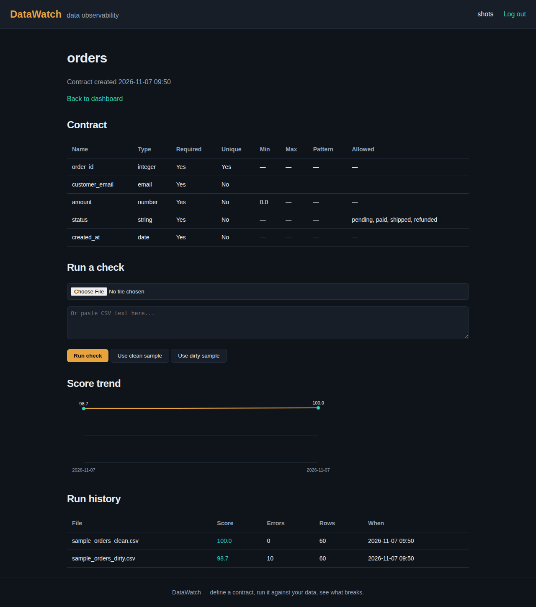

# DataWatch

A data observability platform: define a **data contract** (the schema and rules
a dataset should follow), run it against a CSV upload, and get a violation
report with a quality score — then watch that score over time.

This is Phase 1 of a larger build. It covers contracts, validation runs, run
history with a score trend, and accounts. Scheduled monitoring, alerts, and
column profiling are planned for Phase 2.

## What it does

- **Contract builder** — define columns with a type (`string`, `integer`,
  `number`, `boolean`, `date`, `email`), required/unique flags, min/max,
  regex pattern, and allowed values. Duplicate column names, bad numbers,
  and invalid regexes are rejected in the form.
- **Validation engine** — checks every row against the contract: required
  values, types, ranges, patterns, allowed values, uniqueness, and missing
  columns. Every violation names its row, column, rule, and offending value.
- **Run history** — every run is stored in SQLite with its score, error
  count, and violations. The dataset page shows a score-trend chart and a
  run history table.
- **Accounts** — sign up and log in; each user only sees their own datasets
  and runs. Passwords are hashed with PBKDF2-HMAC-SHA256.
- **Upload, paste, or sample** — run a check from a CSV file, pasted CSV
  text, or one of the two bundled samples. Violations download as CSV, and
  run history is available as JSON.

## Example output

The bundled samples are a 60-row orders file (`order_id`, `customer_email`,
`amount`, `status`, `created_at`) run against the orders contract:

| File | Score | Checks | Errors |
| --- | --- | --- | --- |
| `sample_orders_clean.csv` | 100.0/100 (Pass) | 780 | 0 |
| `sample_orders_dirty.csv` | 98.7/100 (Fail) | 775 | 10 |

The dirty file's 10 violations: 2 missing required values, 4 type errors
(bad email, non-numeric amount, bad date, non-integer order id), 1 range
error (negative amount), 2 allowed-value errors, 1 duplicate order id.






## Run it

Requires Python 3.10+.

```bash
python -m venv .venv
source .venv/bin/activate
pip install -r requirements.txt
python app.py
```

Open http://127.0.0.1:5001, sign up, create a dataset (the builder comes
prefilled with the orders contract), and run the dirty sample.

Set `DATAWATCH_SECRET` to a long random value in production; without it the
app generates an ephemeral secret at startup and sessions do not survive a
restart. Set `DATAWATCH_DEBUG=1` to enable Flask debug mode (off by default).
Uploads are limited to 5 MB.

## API

- `GET /api/datasets/<id>/runs` — JSON list of runs for a dataset (login
  required; 401 when logged out).

## Phase 2 — monitoring, alerts, profiling

- **Column profiling** — every run now stores per-column stats: row and null
  counts, null %, distinct values, min/max/mean/median for numeric columns,
  earliest/latest for dates, and the five most common values for text
  columns. Shown in a "Column profiles" table on the run page.
- **Scheduled monitoring** — on a dataset page, pick an interval (every 15
  minutes, hourly, every 6 hours, daily) and enable monitoring. While the
  server is running, a background thread re-checks the dataset's latest
  uploaded file on that schedule and saves each re-check as a run. "Run now"
  re-checks it right away. A schedule with no uploaded file yet just waits —
  it never spins.
- **Alerts** — set rules per dataset: alert when a run's score falls below a
  number (0–100), or when its error count goes above a number. Broken rules
  create in-app alerts (no email) with the real score or error count in the
  message. The nav bar shows the unread count, the dashboard lists recent
  alerts, and each alert can be acknowledged on the Alerts page.

Limit: scheduled checks only run while the server is running. Stop the
server and the schedule pauses; it resumes where it left off when the
server starts again.

## Tests

```bash
python -m pytest tests/ -q
```

73 tests: engine rules (required/type/range/pattern/allowed/unique/missing
column, scoring, BOM and duplicate-header handling), store CRUD, auth
hashing, the SVG trend chart, and the Flask routes end to end (register,
login, dataset creation, sample runs, export, per-user isolation), plus
Phase 2 coverage for profiling math, the scheduler and alert rules, and
the monitoring/alerts routes (including per-user isolation).

## Project layout

```
app.py            Flask app: routes, auth, CSRF, upload handling
engine.py         contract validation (stdlib only)
profile.py        per-column profiling (stdlib only)
monitor.py        shared run execution, alert checks, scheduler thread
store.py          SQLite persistence (datasets, runs, violations, schedules, alerts)
auth.py           PBKDF2 password hashing
charts.py         SVG score-trend chart
templates/        Jinja pages (dashboard, builder, dataset, run, auth, alerts)
static/style.css  dark amber/teal theme
data/             bundled clean/dirty order samples + generator
tests/            pytest suite
```

## Roadmap

Live deployment next.
